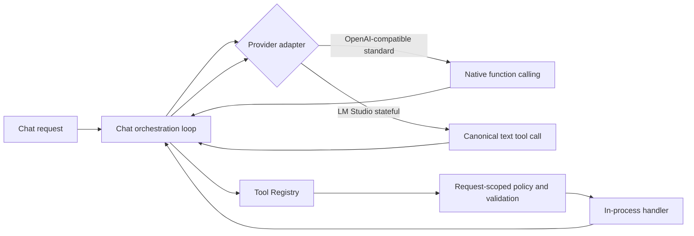

# App Tool Runtime

DKST LLM Chat Server는 모델 공급자에 도구 실행을 위임하지 않습니다. 도구 카탈로그, 사용자별 정책, 인자 검증, 실행과 결과 반환을 모두 앱 프로세스가 담당합니다.

## 책임 경계

- `internal/toolruntime`: 도구 등록, 조회, 사용자별 노출 필터, 필수 인자 검증, 실행을 담당합니다.
- `internal/chatharness`: 공급자 요청 형식과 스트리밍 tool call 조립, tool result 후속 요청을 담당합니다.
- `internal/core/server.go`: 요청 단위 실행 컨텍스트를 만들고 제한된 순차 도구 루프를 오케스트레이션합니다.
- `internal/promptkit`: 네이티브 custom tools를 지원하지 않는 stateful 경로에 동일한 도구 카탈로그와 단일 canonical 호출 형식을 제공합니다.
- `internal/mcp`: 기존 도구 구현과 메모리 저장소가 남아 있는 내부 패키지 이름입니다. 외부 MCP 서버나 전역 사용자 컨텍스트로 사용하지 않습니다.

## 공급자 동작

- OpenAI-compatible `standard`: Chat Completions `tools`를 전송하고, 스트리밍 `tool_calls`를 index별로 합친 뒤 `role: tool`과 `tool_call_id`로 결과를 돌려줍니다.
- LM Studio `stateful`: `/api/v1/chat`의 대화 상태를 유지하면서 `<tool_name>{...}</tool_name>` 형식을 사용합니다. 예를 들어 현재 시간은 `<get_current_time>{}</get_current_time>`으로 호출하며, 앱이 이를 실행하고 같은 stateful 대화에 결과를 반환합니다.
- LM Studio가 도구 호출문을 `message.delta`와 `chat.end.result.output`에 중복해서 보내더라도 Gateway는 호출문을 UI에 전달하지 않고 한 번만 실행합니다.
- 일부 로컬 모델이 `<tool_name>{...}</tool_name>` 대신 `tool_name(key="value")` 형태를 출력하는 경우에도 등록된 도구 이름만 인식하여 JSON 인자로 정규화하고 실행합니다.
- 도구 실행 후 후속 요청에는 원래 사용자 요청과 응답 언어 유지 조건을 함께 전달하므로, 도구 결과가 영어여도 답변 언어가 바뀌지 않습니다.
- `execute_command`는 런타임 OS에 맞는 명령 가이드를 사용합니다. Darwin/BSD, Linux/GNU, Windows/PowerShell을 구분하며, 명령 실패는 성공으로 처리하지 않고 stderr와 함께 모델에 반환하여 안전한 플랫폼별 대안을 직접 재시도하게 합니다.
- 두 경로 모두 같은 Registry와 사용자별 `disabled_tools`, 메모리 사용 여부, 명령/디렉터리 제한을 사용합니다.
- Terminal Assistant 전용 `send_keys`, `read_terminal_tail`은 Gateway Registry에 노출하지 않습니다.

## 새 도구 추가

### Computer use (macOS)

`internal/computeruse`는 서버 Mac의 실제 데스크톱을 제어하며 `internal/toolruntime/computer.go`에서 도구를 직접 등록합니다. macOS/cgo 빌드에서만 도구가 노출됩니다.

- `computer_list_apps`: 실행 중인 GUI 앱의 이름, bundle ID, 경로, PID 조회
- `computer_launch_app`: 앱 이름, bundle ID 또는 절대 `.app` 경로로 실행 및 활성화 요청
- `computer_switch_app`: 조회한 PID로 앱 전환 요청
- `computer_observe`: 기본 디스플레이 이미지, 전면 앱, 창 목록, 일회용 `observation_id` 반환
- `computer_click`, `computer_type`, `computer_key`, `computer_scroll`: 화면 좌표 클릭, Unicode 입력, 단축키, 스크롤

사용자 편집의 **컴퓨터 제어 (macOS)** 토글로 전체 도구를 켜거나 끌 수 있습니다. 앱을 빌드하여 실행한 뒤 시스템 설정 → 개인정보 보호 및 보안에서 Gateway 앱의 **화면 기록**과 **손쉬운 사용** 권한을 허용해야 합니다. 화면 이미지를 이해하며 도구를 호출할 수 있는 모델이 필요합니다. 조작 대상은 원격 채팅 클라이언트가 아니라 서버 Mac입니다.

스크린샷은 긴 변을 최대 1440픽셀로 줄여 이미지 입력으로 전달합니다. 호환 Chat Completions에는 `image_url`, LM Studio native에는 `type: image`/`data_url`로 보냅니다. 호환 대화에는 최신 데스크톱 이미지만 유지하고 일반 사용자 첨부 이미지는 보존합니다. 캡처 임시 파일은 반환 전에 삭제하며 이미지 본문은 도구 결과 로그에 넣지 않습니다.

입력은 같은 요청의 최신 관찰 ID를 요구하고 한 번 사용하면 무효화합니다. 좌표는 스크린샷 픽셀 기준이며 Retina 배율을 변환합니다. 관찰 ID는 1분 후 만료되며 다른 요청의 캡처·앱 실행·앱 전환으로도 무효화됩니다. 입력 직전 전면 앱 PID를 다시 확인합니다. 데스크톱 호출은 직렬화하고 요청 취소를 전달합니다. 앱 전환이나 입력 이벤트 전송 성공은 작업 완료를 뜻하지 않으므로 이후 화면을 확인해야 합니다.

Computer use 도구는 상태가 변하므로 일반 중복 호출 차단에서 제외합니다. 입력 재실행은 일회용 관찰 ID로 차단하므로 화면 재관찰과 A→B→A 앱 전환이 가능합니다. 기본 사용 절차는 `bundle/skills/builtin/computer-use/SKILL.md`에 있습니다. 현재 다중 디스플레이 선택, 드래그 및 Windows/Linux 데스크톱 제어는 지원하지 않습니다.

데스크톱 도구가 활성화된 채팅에서 화면·창·탭 조작 또는 앱 내부 상태 확인을 나타내는 요청만 별도의 의도 분류를 거칩니다. 날씨와 호스트 메모리량 같은 단독 조회는 이 분류를 건너뜁니다. 분류 요청에는 Computer use 스킬이나 작업 계획을 넣지 않으며 현재 요청의 원문 근거로 `chat` 또는 `desktop`을 판단합니다. 날씨·일반 검색·설명·인사 등은 기존 채팅 경로로 처리하고, 이 경로에서는 데스크톱 도구와 절차를 제거합니다. 분류 실패도 일반 채팅으로 복귀하며 계획 생성 오류로 일반 답변을 막지 않습니다. 이전 데스크톱 대화가 새 주제에 적용되지 않도록 구분합니다.

실제 데스크톱 조작 의도가 확인된 경우에만 `internal/core/computer_task.go`의 공통 작업 실행기로 계획을 만듭니다. 최대 6개 단계에 목표·완료 조건·화면 검증 여부를 부여하고, 이후 검증 응답에서 매번 도구 하나만 선택합니다. `/v1/chat/completions`의 `response_format: json_schema`와 화면 이미지 입력을 지원하는 모델이 필요하며, 계획과 단계 검증을 위한 추가 추론이 발생합니다. 로컬 Qwen 템플릿이 구조화 결과를 `reasoning_content`로 반환하는 경우에는 해당 필드 전체가 완전한 JSON 객체일 때만 내부 제어 응답으로 파싱합니다. 추론 문장에서 JSON을 추출하거나 추론 원문을 UI에 표시하지 않습니다.

실행기는 실제 도구 결과에 번호를 붙여 기록합니다. 완료 단계는 성공한 결과 번호를 인용해야 하며 화면 검증 단계에는 성공한 캡처가 필요합니다. 마지막 조작 후 최신 화면을 확인하지 않았거나 미완료 단계가 남으면 전체 완료를 거부합니다. 형식·근거 검증 실패는 한 번 수정하게 하고, 같은 단계에서 도구가 두 번 실패하거나 32회 실행 제한에 도달하면 미완료로 중단합니다. 화면의 의미와 완료 조건 충족 여부는 모델이 판단하고 런타임은 실행·근거·상태 조건을 검증합니다. 목표·단계별 상태는 `task.progress`로 UI에 표시하고 현재 채팅 스냅샷에 저장하여 재접속 후에도 복원합니다.

상태·내용 조회에는 `computer_type`을 노출하지 않고, 키 입력도 탐색 키로 제한합니다. 사용자 요청에서 실제 필드 입력 지시의 원문 근거가 확인된 경우에만 문자 입력을 허용합니다. 대상 앱이 명시된 작업은 최신 관찰의 전면 앱과 대상 앱이 일치해야 완료할 수 있습니다. 완료 응답에는 구체적인 관찰값(`findings`)을 요구하고, 별도의 화면 검증 응답으로 그 값이 실제 화면에서 요청한 정보를 나타내는지 확인합니다. 자체 채팅의 계획·완료 주장이나 “정보가 표시됨”만으로는 작업을 완료하지 않습니다. 이 검증도 모델의 화면 이해 정확도에 영향을 받습니다.

Gemma가 읽기 전용 도구를 `search_web` 다음 줄의 `query: 검색어` 같은 형태로 출력하면, 등록된 도구·스키마의 문자열 인자만 복구하여 실행합니다. 설명 문장, 중복 인자, 알 수 없는 인자 및 부작용이 있는 도구는 이 복구 경로로 실행하지 않습니다.

공통 스킬은 앱별 고정 절차 대신 사용자 요청의 완료 기준을 따릅니다. 목록 요청은 목록으로 답하되, 앱 내부 정보·진행 상황 확인은 앱 전환 → 화면 관찰 → 필요한 패널 탐색 → 결과 재관찰까지 이어갑니다. 이 범위의 전환·관찰을 다시 허락받지 않으며 상태 확인 중 작업 취소나 설정 변경은 하지 않습니다. Gemma 호환 경로에도 같은 후속 지침을 전달하여 앱 조회 뒤 방법만 설명하고 종료하지 않도록 합니다. 실제 권한·대상 식별 문제나 반복 실패가 있으면 확인한 내용과 미완료 부분을 보고합니다.

### 등록 방식

현재 전환 단계에서는 다음 순서로 추가합니다.

1. `internal/mcp.GetToolList`에 이름, 설명, JSON Schema를 추가합니다.
2. `internal/mcp.ExecuteToolWithContext`에 구현을 연결합니다. 사용자나 위치 같은 상태는 반드시 전달된 `ToolContext`만 사용합니다.
3. 필요하면 `internal/toolruntime.metadataFor`에 카테고리, 읽기 전용 여부, 메모리 요구 여부를 지정합니다.
4. Registry 목록/정책/실행 테스트와 공급자 요청 fixture를 추가합니다.

장기적으로 각 도구를 독립 패키지의 `Definition + Handler`로 직접 등록하면 기존 `internal/mcp` 이름과 switch dispatcher도 제거할 수 있습니다. 공급자 어댑터와 오케스트레이션 계층은 변경할 필요가 없습니다.

## 안전 원칙

- 사용자, 위치, 비활성 도구, 명령 제한은 전역 상태가 아니라 매 요청의 `ExecutionContext`로 전달합니다.
- 클라이언트가 보낸 `tools`/`functions` 제어값은 제거하고 앱 Registry에서 필터링한 카탈로그만 공급자에 전달합니다.
- 서버가 `parallel_tool_calls: false`를 보내며 한 번에 하나의 호출만 실행합니다.
- 도구가 비활성화되었거나 필수 인자가 없으면 handler 진입 전에 실패합니다.
- 외부 `/mcp/sse`, `/mcp/messages` transport는 제공하지 않습니다.
