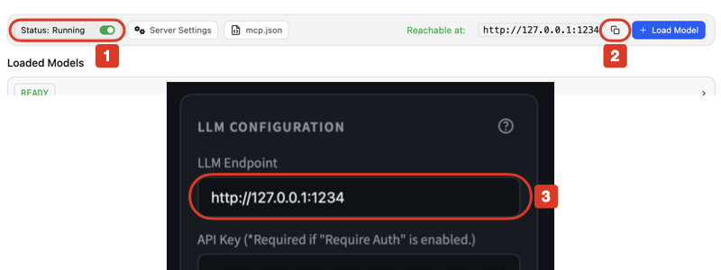
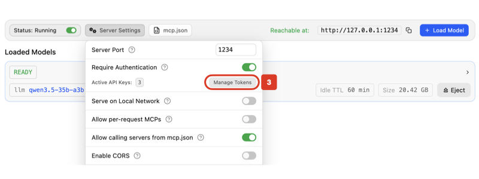
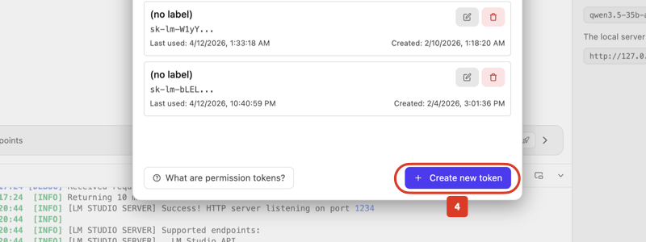
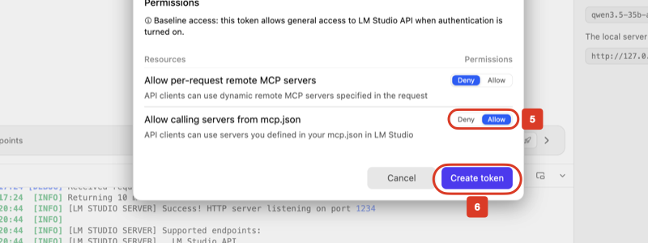
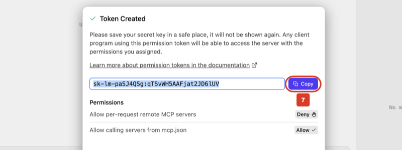
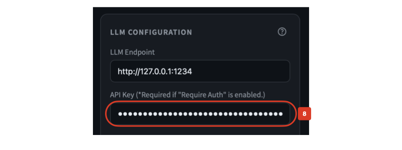

<!--lang:en-->
# 🛠️ How to Integrate with LLMs

## 1. Connecting with LM Studio (Recommended)

To establish a connection, follow these steps within the **LM Studio** application:

* **Access Developer Tab** Navigate to the **Developer Tab**
> `Ctrl + 2` (Windows/Linux)
> `Cmd + 2` (macOS)

---

* **Start the Server** Toggle the switch 1 next to **Status: Stopped** to start the local server.
    Click the **Copy** 2 button next to the **Reachable at** address, then return to the **DKST LLM Chat Server** and paste it into the **LLM Endpoint** 3 field.

 
  
---

**Back in LM Studio:**

* **Configure Server Settings** Click on **Server Settings** to adjust the following:
    * **Server Port:** You may change the port number here if necessary.
    * **Authentication:** Toggle **Require Authentication** to **ON**.

* **Generate API Token** 1. Click the **Manage Tokens** 3 button.

 
  

    2. Click **+ Create new token** 4.

 

    3. Click **Create token** 6. App tools run inside DKST LLM Chat Server, so no MCP permission or `mcp.json` setup is required.

 
  

    4. Click the **Copy** 7 button next to the newly generated token.

 
  

---

**Back in DKST LLM Chat Server:**

* **Finalize Setup** Paste the copied token into the **API Key** 8 field.

 
  

---

## 2. Connecting with OpenAI-Compatible Runtimes

* **Ollama**
    * You can also connect via other OpenAI-compatible APIs, such as Ollama, by providing the local host address and the corresponding model name.

## 3. Connect Even to an account

Open **Account Management → Edit Account → openclaw connection**. Select a target model and click **Issue token**. This enables the connection. Copy the **Even server URL** and **API Token** into Even. The token is shown only at issuance; copy it before closing the account window. Changes apply immediately.

The token selects this DKST account. Requests use its target model, upstream API keys, personal memory and tool permissions. The token is restricted to `openclaw` chat requests. LM Studio API keys stay in the account's LLM connection settings. Regenerating a token or disabling the connection invalidates the old token; deleting the account also revokes access. Browser session tokens are not needed. Saved account tool, memory and context settings also apply. Retrieval uses the account’s shared recent conversation and personal memory; history mode requires Even to send earlier messages. Web and Even share the current account conversation. Tool progress cards and other web-only displays may not appear in Even.

The endpoint is `http://<DKST server IP>:<HTTP API port>/v1/chat/completions`. For external access, edit **Even server URL** to your reachable public domain and port, such as `https://chat.example.com/v1/chat/completions`. The address is saved for this account without changing its token. Leave it blank to restore the automatic local address. This is a text chat connection; it does not enable speech recognition.
<!--/lang-->

<!--lang:ko-->
# 🛠️ LLM 연동 방법

## 1. LM Studio와 연결하기 (권장)

**LM Studio** 앱 안에서 아래 순서대로 진행하세요.

* **Developer Tab 열기**
> `Ctrl + 2` (Windows/Linux)
> `Cmd + 2` (macOS)

* **서버 시작**
    * **Status: Stopped** 옆 토글 1을 켜서 로컬 서버를 시작합니다.
    * **Reachable at** 주소 옆의 **Copy** 2 버튼을 눌러 주소를 복사합니다.
    * 다시 **DKST LLM Chat Server**로 돌아와 **LLM Endpoint** 3 칸에 붙여 넣습니다.
    
  
  

---

**다시 LM Studio에서:**

* **Server Settings 설정**
    * 필요하면 **Server Port**를 바꿀 수 있습니다.
    * **Require Authentication**을 **ON**으로 설정합니다.
    

* **API 토큰 생성**
    1. **Manage Tokens** 3를 클릭합니다.
    
  
 
    2. **+ Create new token** 4을 클릭합니다.
    
  
 
    3. **Create token** 6을 누릅니다. 앱 도구는 DKST LLM Chat Server 내부에서 실행되므로 MCP 권한이나 `mcp.json` 설정이 필요하지 않습니다.

    
  
 
    4. 새로 만든 토큰 옆 **Copy** 7 버튼으로 복사합니다.
    
  
 
        

---

**다시 DKST LLM Chat Server에서:**

* **설정 마무리**
    * 복사한 토큰을 **API Key** 칸 8에 붙여 넣습니다.
    
  
 

---

## 2. OpenAI 호환 런타임과 연결하기

* **Ollama**
    * Ollama 같은 OpenAI 호환 API도 로컬 호스트 주소와 해당 모델 이름을 입력해 연결할 수 있습니다.

## 3. 계정별 Even 연결

**계정 관리 → 계정 편집 → openclaw 연결**에서 대상 모델을 선택하고 **토큰 발급**을 누릅니다. 연결이 켜지면 **Even 서버 주소**와 **API Token**을 복사해 Even에 입력하세요. 토큰은 발급할 때만 표시되므로 계정 창을 닫기 전에 복사하세요. 변경 사항은 즉시 적용됩니다.

이 토큰으로 DKST 계정을 구분합니다. 요청은 해당 계정의 대상 모델, LLM API 키, 개인 메모리와 도구 권한을 사용합니다. 토큰은 `openclaw` 채팅에만 사용할 수 있습니다. LM Studio API 키는 계정의 LLM 연결 설정에 입력합니다. 토큰을 재발급하거나 연결을 끄면 기존 토큰은 무효화되며, 계정을 삭제해도 접근할 수 없게 됩니다. 브라우저 로그인 세션 토큰은 필요하지 않습니다. 계정에 저장된 도구·메모리·컨텍스트 설정도 적용됩니다. 검색 기반 컨텍스트는 계정의 최근 대화와 개인 메모리를 사용하며, 대화 이력 방식은 Even이 이전 messages를 함께 보내야 합니다. 웹과 Even은 같은 계정의 현재 대화를 공유합니다. 도구 진행 카드 등 웹 전용 표시는 Even에서 보이지 않을 수 있습니다.

주소 형식은 `http://<DKST 서버 IP>:<HTTP API 포트>/v1/chat/completions`입니다. 외부에서 사용할 때는 **Even 서버 주소**에 외부에서 접속 가능한 도메인·포트를 입력하세요. 예: `https://chat.example.com/v1/chat/completions`. 주소는 계정별로 저장되며 기존 토큰은 유지됩니다. 입력란을 비우면 자동 로컬 주소로 돌아갑니다. 이 연결은 텍스트 채팅용이며 음성 인식을 켜지는 않습니다.
<!--/lang-->
