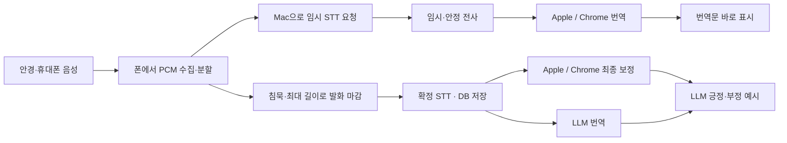

# 실시간 번역 지연 검토 — 2026-11-16

검토 대상: 현재 Even G2 플러그인의 Whisper/Apple/Chrome STT × Apple/Chrome/LLM 번역 9개 조합. 아래 본문은 개선 전 검토와 측정이다. 이후 반영한 2.18.0 변경은 바로 아래에 정리했다.

## 후속 적용 — 2.18.0

검토의 개선 우선순위를 다음처럼 반영했다.

| 검토 항목 | 반영 |
|---|---|
| 구간별 계측 | STT 왕복/서버/잠금/엔진/저장, 번역 대기/왕복/서버/첫 표시, SDK 전송과 PCM 전송량. 숫자만 bounded 메모리에 보관 |
| Chrome 공통 잠금 | 생명주기 RW 잠금과 음성/번역별 작업 잠금 분리. 임시 프로필 합성 브라우저 테스트 통과 |
| busy 재준비 | 429는 bounded backoff. 준비 필요 상태만 강제 준비. Chrome/Apple 요청 취소 전달 |
| 고정 500ms 지연 | 시작 기준 250ms로 변경. 최신 대기본 하나·최종 우선·이전 번역 유지 |
| 누적 PCM 반복 업로드 | 지원 협상 후 byte offset 기반 추가분만 전송. 누락/재시작 때 full 복구. 최종 저장은 full 보존 |
| LLM 확정 대기 | 안정된 완결 문장의 프리뷰 번역, 문장 캐시. 별도 번역 전용 no-tools/stateless/thinking-off 정책 |
| 예시 취소/덮어쓰기 | 로컬 번역 프리뷰와 예시 생성을 분리. 이전 예시의 늦은 완료가 최신 번역을 덮어쓰지 않음 |
| 안경 표시 지연 | 본문 전송 우선 처리와 SDK 완료 계측. 블루투스의 실측 지연은 기기에서 확인 필요 |

원래의 합성 큐 재현(80ms 번역, 0/120/240ms에 세 수정본 제출)을 같은 조건에서 실행한 최신 결과:

| 가상 RTT | 개선 전 최신 수정 표시 | 개선 후 최신 수정 표시 |
|---|---:|---:|
| 10ms | 약 685ms | 약 341ms |
| 150ms | 약 963ms | 약 482ms |

이는 실제 큐의 합성 지연 비교이며 실제 엔진·Wi-Fi·안경의 전체 성능 측정은 아니다. 설치된 Apple 언어쌍 준비 후 native 직접 측정은 40/120/400자 중앙값 약 54/81/198ms였고, 로컬 Gemma의 합성 스트리밍 번역은 첫 표시 약 917ms/완료 약 1,064ms였다. 샘플·언어·부하에 따라 달라진다.

Chrome 음성의 구간 순서와 VAD·DB 저장은 정확도와 보존을 위해 유지했다. 단일 Whisper/Apple STT 모델을 무작정 병렬 실행하거나 VAD를 일괄 단축하지 않는다. 새 LLM 프리뷰도 안정된 문장 경계가 없는 동안에는 기다린다. **서버와 안경 앱을 함께 업데이트해야 한다.**

## 결론

확정 대기·엔진 잠금·큐 대기가 번역 지연에 실제로 영향을 준다. 네트워크도 영향을 주지만 휴대폰→Mac 실제 경로를 측정하지 않아 주원인으로 단정할 수 없다. Apple/Chrome 번역은 임시 전사부터 표시하고, LLM 번역과 모든 긍정·부정 예시는 발화 확정을 기다린다. **화면의 번역문 지연과 하단 답변 예시 지연은 별개다.**

## 1. 경로와 확정의 의미

- 임시 전사: local 번역은 이 값으로도 동작한다. `isFinal`이나 LocalAgreement의 완전 합의를 기다리는 게이트는 아니다.
- 안정된 접두사: 이미 끝난 문장의 번역을 캐시하는 기준이다. Whisper의 LocalAgreement는 이전 추론과의 접두사 합의를 쓰지만 미확정 끝부분도 번역한다.
- 발화 확정: VAD/구간 길이 제한 이후 최종 엔진 처리와 전사 저장까지 끝나야 클라이언트가 최종 전사로 받아들인다. LLM 번역·최종 보정·예시 생성이 이 경로에 의존한다.
- LLM 완료: LLM 번역은 STT 확정 후 시작하지만, 번역 JSON 문자열 자체는 SSE 수신 중 표시할 수 있다. 긍정·부정은 두 항목이 온전히 완성된 최종 결과에서 교체한다. 같은 모델이면 번역+예시 한 요청, 역할별 모델이 다르면 번역 요청 완료 뒤 예시 요청을 보낸다.

근거: [plugins/even-realities/plugin.js:1763](/Users/dinki/Documents/GitHub/DINKIssTyle-Local-LLM-Gateway-with-TTS/plugins/even-realities/plugin.js:1763), [plugins/even-realities/plugin.js:495](/Users/dinki/Documents/GitHub/DINKIssTyle-Local-LLM-Gateway-with-TTS/plugins/even-realities/plugin.js:495), [plugins/even-realities/translation-display.mjs:4](/Users/dinki/Documents/GitHub/DINKIssTyle-Local-LLM-Gateway-with-TTS/plugins/even-realities/translation-display.mjs:4), [internal/core/stt_models.go:359](/Users/dinki/Documents/GitHub/DINKIssTyle-Local-LLM-Gateway-with-TTS/internal/core/stt_models.go:359).

## 2. 조합별 구조적 병목

다음은 코드 경로 비교이며 9개 실제 엔진의 종합 속도 순위가 아니다. 번역 언어팩과 STT 모델은 준비된 상태를 기준으로 한다.

| STT / 번역 | Apple 번역 | Chrome 번역 | LLM 번역 |
|---|---|---|---|
| Whisper | 임시 번역 가능. 반복 추론·확정 추론의 공통 STT 잠금과 번역 갱신 대기가 우선 병목 | 왼쪽과 동일. Chrome 번역 자체 준비/잠금이 추가될 수 있으나 Whisper STT와 Chrome 잠금은 다름 | 임시 번역 없음. VAD→최종 Whisper→DB 저장→LLM 시작. 같은 장치의 STT·LLM 연산 자원 경쟁 가능성도 측정 필요 |
| Apple | 임시 번역 가능. STT와 번역의 Go 잠금은 분리돼 있으나 STT 프리뷰/확정은 직렬 | 임시 번역 가능. 서로 다른 런타임이며 직접 공통 잠금은 없음. STT 확정·번역 큐 대기는 남음 | Apple 확정·저장 이후 LLM 시작. 빠른 임시 전사가 곧 빠른 LLM 번역을 의미하지 않음 |
| Chrome 온라인 | 임시 번역 가능. Chrome STT의 원격 인식·최종 마감 동안 프리뷰 대기가 영향 | **STT와 번역이 같은 `chromeTranslator.mu`를 공유.** 번역 중 STT busy, STT 중 번역 busy/재준비가 생길 수 있음 | 원격 STT·발화 마감·DB 저장 후 LLM. LLM 자체는 Chrome 잠금을 공유하지 않음 |

근거: [internal/core/stt_runtime.go:177](/Users/dinki/Documents/GitHub/DINKIssTyle-Local-LLM-Gateway-with-TTS/internal/core/stt_runtime.go:177), [internal/core/apple_runtime.go:177](/Users/dinki/Documents/GitHub/DINKIssTyle-Local-LLM-Gateway-with-TTS/internal/core/apple_runtime.go:177), [internal/core/apple_runtime.go:244](/Users/dinki/Documents/GitHub/DINKIssTyle-Local-LLM-Gateway-with-TTS/internal/core/apple_runtime.go:244), [internal/core/chrome_speech.go:37](/Users/dinki/Documents/GitHub/DINKIssTyle-Local-LLM-Gateway-with-TTS/internal/core/chrome_speech.go:37), [internal/core/chrome_translation.go:245](/Users/dinki/Documents/GitHub/DINKIssTyle-Local-LLM-Gateway-with-TTS/internal/core/chrome_translation.go:245).

## 3. 확정 및 갱신 대기의 실제 설정

| 항목 | 현재 설정·영향 |
|---|---|
| Whisper 프리뷰 | 1초 오디오 증가마다 시도, 최초 스냅샷 최소 1.2초. 실제 주기는 추론·업로드·429 재시도로 더 길어질 수 있음 |
| Apple/Chrome 프리뷰 | 0.25초 오디오 증가마다 시도, 최소 스냅샷 0.25초·발화 0.15초. 브라우저/블루투스 배치와 처리 속도가 실제 주기를 제한 |
| Whisper 발화 마감 | 기본 침묵 900ms 또는 최대 12초 |
| Apple 번역 모드 발화 마감 | 침묵 900ms 또는 최대 8초, 이어서 native finalize 수행 |
| Chrome 번역 모드 발화 마감 | 침묵 1,600ms 또는 최대 20초. 추가 400ms 분량 무음 입력, 최종 이벤트 대기/900ms 보완 타이머, 100ms 폴링. 400ms는 입력 오디오 길이여서 고정 wall-clock 대기로 더하면 안 됨 |
| 번역 프리뷰 큐 | 동일 문장의 **이전 번역 완료 후** 다음 프리뷰까지 500ms. 500ms 간격 고정 실시간 실행이 아님 |
| 같은 문장의 수정 | 실행 중 번역을 즉시 중단하지 않고 최신 대기본 하나를 보관. 오래 걸리는 진행 작업은 최신 수정본을 지연시킬 수 있음 |
| 새로운 문장/최종 번역 | 오래된 클라이언트 번역 작업을 취소해 최신 것으로 교체. 최종은 500ms 대기를 우회하지만 서버/런타임 작업이 즉시 중단된다는 보장은 없음 |
| 느린 최종 STT | 번역 모드는 확정 오디오를 보존·재시도한다. 64구간 또는 약 120초 PCM 대기 한도에서 녹음을 일시 정지하므로 장기 과부하는 실제 멈춤으로 나타날 수 있음 |

근거: [plugins/even-realities/audio-segments.mjs:18](/Users/dinki/Documents/GitHub/DINKIssTyle-Local-LLM-Gateway-with-TTS/plugins/even-realities/audio-segments.mjs:18), [plugins/even-realities/live-translation.mjs:1](/Users/dinki/Documents/GitHub/DINKIssTyle-Local-LLM-Gateway-with-TTS/plugins/even-realities/live-translation.mjs:1), [internal/core/chrome_speech.go:128](/Users/dinki/Documents/GitHub/DINKIssTyle-Local-LLM-Gateway-with-TTS/internal/core/chrome_speech.go:128), [plugins/even-realities/plugin.js:1830](/Users/dinki/Documents/GitHub/DINKIssTyle-Local-LLM-Gateway-with-TTS/plugins/even-realities/plugin.js:1830).

## 4. 확정 처리와 프리뷰의 분리는 아직 부분적

- 프런트엔드에서는 Apple/Whisper 번역 프리뷰를 최종 전사 큐와 별도로 진행시킨다. 그러나 Whisper는 `sttLock` 하나, Apple은 `appleSpeechMu`와 Swift `speechWork` 직렬 처리를 사용하므로 확정 처리 중 다른 프리뷰가 실제 병렬 추론되지는 않는다. 프리뷰의 busy 응답은 300ms 뒤 재시도한다.
- Chrome은 프런트엔드에서도 `draining`/최종 전사 대기가 있으면 프리뷰를 보류한다. 따라서 최종 마감·네트워크·저장 지연이 다음 실시간 자막/번역에도 전파될 수 있다.
- Apple native는 다른 음성 세션으로 전환할 때 이전 세션을 종료하고 필요하면 전체 PCM으로 재구성한다. 프리뷰와 보관용 확정이 교차할수록 추가 작업이 생길 여지가 있다.
- DB 저장은 STT 잠금과 별개일 수 있지만, 확정 API 응답은 저장 성공 뒤 반환하므로 최종 번역과 예시 시작 경로에는 포함된다. 실제 저장 소요 시간은 이번에 별도 측정하지 않았다.

## 5. 네트워크 영향

음성은 폰→게이트웨이, 로컬 번역도 텍스트로 폰→게이트웨이를 왕복한다. 준비 완료·캐시 적중 상태의 첫 번역에는 최소한 STT 응답과 번역 응답의 두 왕복이 포함된다. 준비·설정 조회·재시도는 왕복을 더 늘릴 수 있다.

특히 현재 프리뷰는 매번 **누적 PCM 전체를 Base64로 재전송**한다. 16kHz/16bit/mono는 초당 32KB, Base64는 약 42.7KB다. Apple/Chrome 런타임이 내부적으로 새 오디오만 추가하더라도 폰→Mac POST 자체는 전체 스냅샷이다.

이상적으로 0.25초마다 모두 전송할 수 있다고 가정하면:

- 8초: 32개 누적 스냅샷 합계 약 5.63MB + 최종 요청. 한 번 전송하면 약 0.34MB.
- 20초: 80개 합계 약 34.56MB + 최종 요청. 한 번 전송하면 약 0.85MB.

이는 **구현상 상한 예시이며 실측 트래픽이 아니다**. 실제로는 한 요청 처리 중 최신 대기본만 남겨 전송 횟수가 줄어든다. 그래도 긴 발화·약한 Wi‑Fi에서 업로드 시간과 혼잡이 증가할 구조다. 불안정한 인터넷은 `chrome-online` STT에도 별도로 영향을 준다(`processLocally=false`). 설치 완료된 Apple/Chrome 번역의 문장별 추론과 언어팩 최초 다운로드는 구분해야 한다. LLM이 원격 서버라면 해당 경로의 RTT와 대역폭도 추가된다.

## 6. 이번 측정

### 현재 Apple 번역 native 직접 호출

현재 빌드의 Apple helper에 합성 영어를 넣어 한국어로 번역했다. 준비된 언어팩, 각 길이 3개 warm 표본의 중앙값이며 HTTP/STT/폰/안경 전송은 제외했다.

| 입력 길이 | 중앙값 |
|---|---:|
| 40자 | 50.38ms |
| 120자 | 79.25ms |
| 400자 | 189.84ms |

이 표본에서는 native 번역보다 고정 500ms 갱신 대기, 침묵 판정, STT 확정 지연이 더 큰 항목이 될 수 있다. 모든 언어/장기 동시 부하에서 동일하다는 뜻은 아니다. 이번에는 마이크를 켜거나 Chrome/Whisper STT의 실제 음성을 재생하지 않았다.

### 게이트웨이 컴퓨터 자신의 HTTP

`/api/health/live` 12회에서 최초를 제외한 중앙값: loopback 0.45ms, 자신의 LAN 주소 0.52ms. **두 측정 모두 Mac에서 시작했으므로 iPhone Wi‑Fi RTT를 의미하지 않는다.** 폰→Mac·안경 Bluetooth·원격 Chrome STT 서버 지연은 미측정이다.

### 실제 큐 모듈의 합성 지연 재현

실제 `LiveTranslationQueue`에 번역 80ms와 가상 네트워크 왕복 지연을 넣고 같은 문장을 0/120/240ms에 수정했다. 실제 네트워크나 번역 엔진 속도 측정은 아니다.

| 가상 RTT | 첫 표시 | 최신 수정 표시 |
|---|---:|---:|
| 10ms | 약 92ms | 약 685ms |
| 150ms | 약 232ms | 약 963ms |

이전 작업 완료 + 500ms + 다음 작업 처리 시간이 누적되는 것을 재현했다. RTT가 증가하면 반복 요청의 처리 가능한 빈도도 낮아져 단순 왕복 차이보다 체감 차이가 커질 수 있다.

## 7. 추가 지연 증폭 경로

- 번역이 busy/일시 실패한 경우 `translateLocal`이 실패 종류를 구분하지 않고 강제 준비→재시도한다. Chrome STT와 공유 잠금 때문에 발생한 짧은 busy도 재준비로 확대될 수 있다.
- 준비 대기는 최대 약 185초, 로컬 번역 요청은 8초 제한이다. 실패 후 강제 준비·재시도·최종 LLM 대체가 이어지면 화면에는 이전 번역이 오래 남는다.
- Chrome 번역 내부의 일부 오류 복구는 350/700/1,050ms 대기를 추가할 수 있다.
- 안정된 완결 문장은 캐시하지만, 구두점 없이 커지는 문장은 전체를 다시 번역한다. Chrome 구간 연결은 최대 약 20초/400자로 제한돼 있으나 그 안에서는 요청 크기가 계속 커진다.
- 다음 문장의 토큰이 발급되면 이전 LLM 작업을 취소한다. 로컬 번역에서는 새 문장의 임시 전사도 이전 답변 예시 생성을 중단할 수 있고, LLM 번역에서는 다음 확정 전사가 이전 번역 작업을 중단할 수 있다. 하단 예시가 늦거나 교체되지 않는 현상과 번역문 자체 지연을 구분해야 한다.
- 순수 LLM 번역 요청은 `glasses_client`만으로 일반 도구 설정을 자동 차단하지 않는다. 추론·도구·큰 모델 로딩이 실제 사용되는지 확인해야 하며, 번역 전용 정책/모델 예산 분리가 필요하다. 이번에 도구 호출이 실제 발생한 것까지 측정한 것은 아니다.
- 폰 화면 반영 이후에도 SDK/Bluetooth 직렬 전송·레이아웃 재구성이 남는다. 폰은 빠른데 안경만 느리면 이 구간을 따로 재야 한다.

## 8. 개선 우선순위

1. **계측**: 번역 모드에 오디오 마지막 샘플, 프리뷰 생성/발송/수신, 서버 잠금 대기/추론/저장, 번역 제출/발송/수신, 폰 표시, SDK 전송 완료를 분리해 기록한다. 서버 처리 시간은 `Server-Timing` 또는 duration 필드로 전달해 시계 차이와 구분한다. HTTP 시간에서 처리 시간을 빼도 순수 네트워크만 남는 것은 아니다.
2. **Chrome STT·번역 잠금 분리**: 브라우저 생명주기 잠금과 긴 번역 작업/음성 작업을 분리한다. 음성 스트림을 번역 오류 복구 때문에 재시작하지 않는 기존 동작을 보존해야 한다.
3. **busy와 준비 실패 분리**: 429는 최신 작업의 짧은 재시도/보류로 처리하고 언어팩 재준비를 유발하지 않게 한다.
4. **프리뷰 갱신 주기 조정**: 완료 후 고정 500ms 대신 제출/시작 기준 속도 제한, 의미 있는 변경 최소량, 최종 우선 정책을 검토한다. 작은 프리뷰마다 서버 작업을 취소해 재시작하면 역효과가 날 수 있다.
5. **오디오 증분 전송**: Apple/Chrome은 실제 추가분과 byte offset을 전송하고 구간별 bounded ring buffer와 재동기화 프로토콜을 둔다. Whisper도 서버 버퍼로 중복 업로드를 줄이되 재추론 비용은 별개로 다룬다.
6. **STT 확정·LLM 경로**: 저장/보정은 보존하면서 안정된 텍스트를 먼저 번역하는 정책을 검토한다. 특히 LLM 번역의 안정 문장 프리뷰, 번역 전용 no-tools/no-thinking 정책, 예시 생성의 별도 예산/취소 정책이 대상이다. VAD 침묵값을 일괄 단축하면 문장 품질과 API 호출량이 나빠질 수 있다.

원시 측정 자료는 `/private/tmp/dkst-translation-review-probe.json`, `/private/tmp/dkst-translation-queue-probe.json`에 있으며 합성 입력만 사용했다. 9개 조합의 실제 end-to-end 분포를 확정하려면 동일 음성·기기·언어쌍으로 iPhone부터 안경 표시까지 계측해야 한다.
